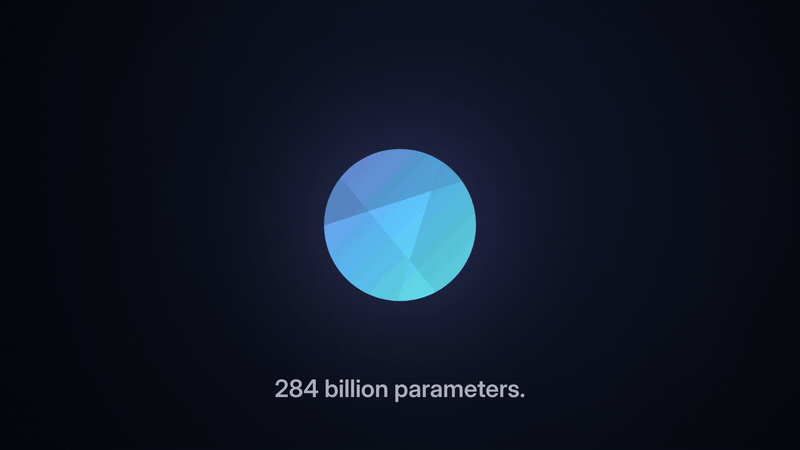
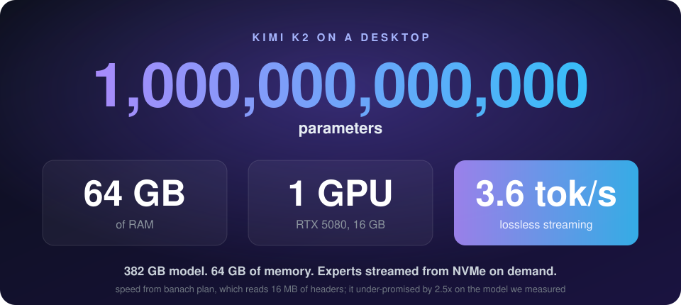
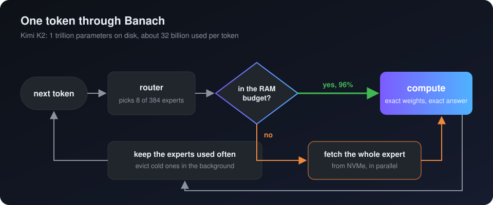

<p align="center">
  
</p>

<h1 align="center">Banach</h1>

<h3 align="center">A trillion parameters on the computer you already own.</h3>

<p align="center">
  Run Mixture-of-Experts models <b>bigger than your RAM</b>, faster than llama.cpp,<br>
  with <b>byte-for-byte the same answers</b>. Know the speed <b>before</b> you download a single weight.
</p>

<p align="center">
  <a href="https://pypi.org/project/banach/"></a>
  <a href="https://github.com/gautam1858/banach/actions/workflows/ci.yml"></a>
  <a href="https://github.com/gautam1858/banach/stargazers"></a>
  <a href="LICENSE"></a>
</p>

<p align="center">
  <a href="brand/video/banach-launch-16x9.mp4"><b>Watch the film</b></a> &nbsp;&middot;&nbsp;
  <a href="#get-started-in-one-line"><b>Get started</b></a> &nbsp;&middot;&nbsp;
  <a href="#the-giants-on-your-machine"><b>The giants on your machine</b></a> &nbsp;&middot;&nbsp;
  <a href="docs/VALIDATION.md"><b>Every number</b></a>
</p>

---

<p align="center">
  
</p>

## The giants on your machine

The biggest open models in the world, on machines you can buy at a normal shop. Speeds from
`banach plan`, which reads only the model headers. It under-promises: on the model we
measured end to end it said **2.1 tok/s**, and Banach delivered **5.4 tok/s**.

| Model | Parameters | On disk | 16 GB, 4 cores<br><sub>1.3 GB/s disk</sub> | 32 GB desktop<br><sub>DDR5, Gen4 NVMe, no GPU</sub> | 64 GB + RTX 5080<br><sub>2x Gen5 NVMe</sub> |
|---|---:|---:|---:|---:|---:|
| **Kimi K2** (UD-Q2_K_XL) | **1 trillion** | 382 GB | 0.2 tok/s | 1.0 tok/s | **3.6 tok/s** |
| **DeepSeek V4 Flash** (UD-Q4_K_XL) | 284 B | 155 GB | 0.4 tok/s | 2.2 tok/s | **10.0 tok/s** |
| **Qwen3 235B-A22B** (UD-Q2_K_XL) | 235 B | 89 GB | 0.3 tok/s | 1.7 tok/s | **7.2 tok/s** |
| **gpt-oss-120b** (F16) | 117 B | 65 GB | 1.0 tok/s | 4.9 tok/s | **24.2 tok/s** |
| **GLM-4.5-Air** (UD-Q2_K_XL) | 106 B | 47 GB | 0.6 tok/s | 2.8 tok/s | **14.9 tok/s** |
| **Qwen3.6-35B-A3B** (UD-Q4_K_M) | 35 B | 22 GB | **5.4 tok/s measured** | 8.8 tok/s | **80.6 tok/s** |

Exact weights in every cell, no lossy shortcuts. Ask about your own machine in ten seconds:

```bash
banach probe && banach plan hf:unsloth/Kimi-K2-Instruct-GGUF/UD-Q2_K_XL/Kimi-K2-Instruct-UD-Q2_K_XL-00001-of-00008.gguf
```

**Ran one of these?** [Post your numbers](https://github.com/gautam1858/banach/issues/new?title=Benchmark:%20MODEL%20on%20MACHINE)
with the output of `banach probe` and `banach run`. Measured results replace the planner's
numbers in this table, with your name on them.

## See it

```console
$ pip install banach

# one trillion parameters, a 64 GB desktop with one gaming GPU: ask first, it reads 16 MB
$ banach plan hf:unsloth/Kimi-K2-Instruct-GGUF/UD-Q2_K_XL/Kimi-K2-Instruct-UD-Q2_K_XL-00001-of-00008.gguf --hw phase1/machines/ref-64gb-rtx5080.json
| Kimi-K2-Instruct  (deepseek2)                                          |
| 381.9 GB on disk, 384 experts x 60 layers, top-8                       |
| Exact                3.56 tok/s  (range 3.00 to 4.12)                  |

# a 22 GB model on a 16 GB machine, from a cold start
$ banach-engine -m Qwen3.6-35B-A3B-UD-Q4_K_M.gguf -f story.txt -n 256 --budget-mb 10000
banach: prefill 18 tok 3.44 s; decode 256 tok 5.40 tok/s, hit 95.7% (page cache 95.7%)

# and the answers are the exact ones
$ banach-engine -m Qwen3.6-35B-A3B-UD-Q4_K_M.gguf -f story.txt -n 64 --budget-mb 10000 --exact-check
exact-check: PASS byte-identical (64 tokens, logits bit-equal at every step)
```

## How a trillion parameters fit

A Mixture-of-Experts model is huge on disk but small per token: Kimi K2 has a trillion
parameters and uses about 32 billion of them for each token. The trick is to have the right
3% in memory at the right moment.

When the file does not fit, plain llama.cpp leaves it to the operating system, which pages
bytes in 4 KB at a time with no idea which experts come next. Banach knows the model:

<p align="center">
  
</p>

- **Plan first.** `banach plan` reads a few MB of headers and works out the speed, the hot
  set and the split across GPU, RAM and disk before you download anything.
- **Stream on purpose.** Whole experts, fetched in parallel the moment the router picks them,
  inside a RAM budget you choose. Experts earn their place by how often they are used.
- **Prove it.** Every configuration is checked against stock llama.cpp, token for token and
  logit for logit, in CI on every commit. Optional faster low-precision experts come with a
  live fidelity meter, so a shortcut is never silent.

## Proof: a model bigger than RAM, measured end to end

**A 22 GB model on a 16 GB machine.** Qwen3.6-35B-A3B (Q4_K_M) on a 4-core cloud VM with no
swap and a 1.27 GB/s disk. Cold start, same prompt, same greedy decode.

| | stock llama.cpp | **Banach** | |
|---|---:|---:|---|
| Default settings | **crashed: out of memory** | **runs** | llama.cpp copies the weights into RAM; Banach streams them |
| Model size vs RAM | | **138%** | 22.1 GB of model, 16 GB of RAM |
| Prompt processing | 7.64 s | **3.44 s** | **2.2x faster** |
| Generation | 4.89 tok/s | **5.40 tok/s** | **+10%** |
| RAM for experts | all it can take | **10 GB, capped** | the rest of your machine stays usable |
| Output | reference | **identical** | every token, every logit, bit for bit |
| Read before you know the speed | the whole 22 GB | **16 MB** | `banach plan` reads 0.07% of the file |

Squeeze the RAM budget further and race llama.cpp paging experts in at that same budget:
**2.1x faster generation**. The stock llama.cpp speed rows run with weight repacking off, the
only way it runs here. Machine, commit and command for every number:
[docs/VALIDATION.md](docs/VALIDATION.md).

**No approximations. No re-quantizing. No quality loss.** The exact weights stay on disk.
Banach just moves them better.

## Get started in one line

```bash
pip install banach
```

The `banach` command and its engine, prebuilt for Linux x86_64, Linux arm64 and macOS on
Apple Silicon. Windows and GPU builds: [from source](#build-from-source).

1. **See the speed before you download:**

   ```bash
   banach plan hf:unsloth/Qwen3.6-35B-A3B-GGUF/Qwen3.6-35B-A3B-UD-Q4_K_M.gguf
   ```

2. **Serve it.** `--lazy` starts answering while the file is still downloading:

   ```bash
   banach serve hf:unsloth/Qwen3.6-35B-A3B-GGUF/Qwen3.6-35B-A3B-UD-Q4_K_M.gguf --lazy
   ```

3. **Use it** from anything that speaks OpenAI or Anthropic, coding agents included:

   ```python
   from openai import OpenAI
   client = OpenAI(base_url="http://127.0.0.1:8080/v1", api_key="local")
   print(client.chat.completions.create(
       model="local", messages=[{"role": "user", "content": "Hello!"}]).choices[0].message.content)
   ```

   ```python
   import anthropic
   client = anthropic.Anthropic(base_url="http://127.0.0.1:8080", api_key="local")
   print(client.messages.create(
       model="local", max_tokens=200, messages=[{"role": "user", "content": "Hello!"}]).content[0].text)
   ```

4. **Watch it live** at `http://127.0.0.1:8080/banach/status`: engine, fidelity meter, download.

## Runs everywhere

| Platform | Backends | Expert streaming |
|---|---|---|
| Linux x86_64 and arm64 | CPU (AVX2, AVX-512, NEON), CUDA, Vulkan | full: hard RAM budget, parallel prefetch, residency checks |
| Windows x86_64 | CPU (CUDA and Vulkan from source) | prefetch, working-set budget |
| macOS, Apple Silicon | CPU, Metal | prefetch, soft budget |
| Any GPU | `--gpu-layers N` | dense layers on the GPU, experts streamed from RAM |

Byte-exact against stock llama.cpp in CI on Linux x64, Linux arm64, macOS and Windows;
CUDA and Vulkan builds compiled in CI.

## Everything in the box

| | |
|---|---|
| **Preflight** | speed, hot set and memory split from 16 MB of headers, before any download |
| **Lossless streaming** | expert RAM budget, parallel whole-expert fetch, frequency-gated admission, background eviction |
| **GPU offload** | dense layers and KV cache on CUDA, Metal or Vulkan; experts stay in RAM |
| **Drop-in APIs** | OpenAI `/v1/chat/completions` and Anthropic `/v1/messages`, streaming, tool use, prefix cache |
| **Smart downloads** | resumable, hot experts first, SHA-256 verified; serve before the download ends |
| **Fidelity meter** | shadow replay against the exact model with anytime-valid confidence bounds |

| Command | What it does |
|---|---|
| `banach plan MODEL` | speed and memory split for your machine, from headers |
| `banach compare REF CAND -f TEXT` | how far a quantization or pruned pack drifts from a reference: top-1 agreement, KL, and a 95% bound on flips |
| `banach pick` | ranks the big open MoE models by predicted speed on your machine, biggest fast one first |
| `banach serve MODEL` | local OpenAI and Anthropic server (`--lazy`, `--gpu-layers N`) |
| `banach run MODEL -p TEXT` | one generation with the planned expert budget |
| `banach pull hf:...` | resumable, prioritised, verified download |
| `banach probe` | measures your memory bandwidth, compute and disk |
| `banach inspect MODEL` | experts, bytes per token, KV per token |
| `banach calibrate MODEL --measured TOK_S` | tunes the planner to your machine from one run |
| `banach certify FLIPS` | confidence certificate on a recorded fidelity run |

## Build from source

```bash
git clone https://github.com/gautam1858/banach && cd banach
cargo build --release
git clone https://github.com/ggml-org/llama.cpp ../llama.cpp
(cd ../llama.cpp && git checkout 9309bf1 && git apply ../banach/engine/patches/0001-banach-precision-ladder.patch)
cmake -S engine -B build-engine -G Ninja -DCMAKE_BUILD_TYPE=Release -DLLAMA_DIR=$PWD/../llama.cpp
ninja -C build-engine banach-engine
export BANACH_ENGINE=$PWD/build-engine/banach-engine
```

- **GPU:** add `-DGGML_CUDA=ON` or `-DGGML_VULKAN=ON` (Metal is on by default on macOS) and
  serve with `--gpu-layers 99`.
- **Windows:** the same steps from a Visual Studio developer prompt; the engine is
  `build-engine\banach-engine.exe`.
- A source build is tuned for your exact CPU and is faster still.

Good to know: one request at a time (others queue); the hard RAM budget is Linux, while macOS
and Windows give identical output with a softer budget; small models (1 to 3B) call tools fine
but are weak coding agents.

## Join in

- **Star the repo** so more people find it.
- **Post your numbers.** Every machine and model measured makes the planner sharper for
  everyone. [Open a benchmark issue](https://github.com/gautam1858/banach/issues/new?title=Benchmark:%20MODEL%20on%20MACHINE).
- **Fund the hardware.** The trillion-parameter runs need big NVMe arrays and GPUs:

<p align="center">
  <a href="https://buymeacoffee.com/gautam1858"></a>
</p>

## Why "Banach"?

The Banach-Tarski paradox: cut one ball into a handful of pieces, reassemble them, and you
have two balls the same size as the first. More model than your machine should hold.

## Credits

Built on llama.cpp and ggml (MIT), which run every kernel. Shaped by the llama.cpp
expert-streaming pull requests (25294, 31469) and MoE cache (29887), by colibri's lossless
NVMe streaming and published measurements, and by research on expert locality (Si et al.,
Liang et al.), mixed-precision experts (SliceMoE, DyMoE, HOBBIT) and betting confidence
sequences (Waudby-Smith and Ramdas).

## License

Apache-2.0, see [LICENSE](LICENSE).
